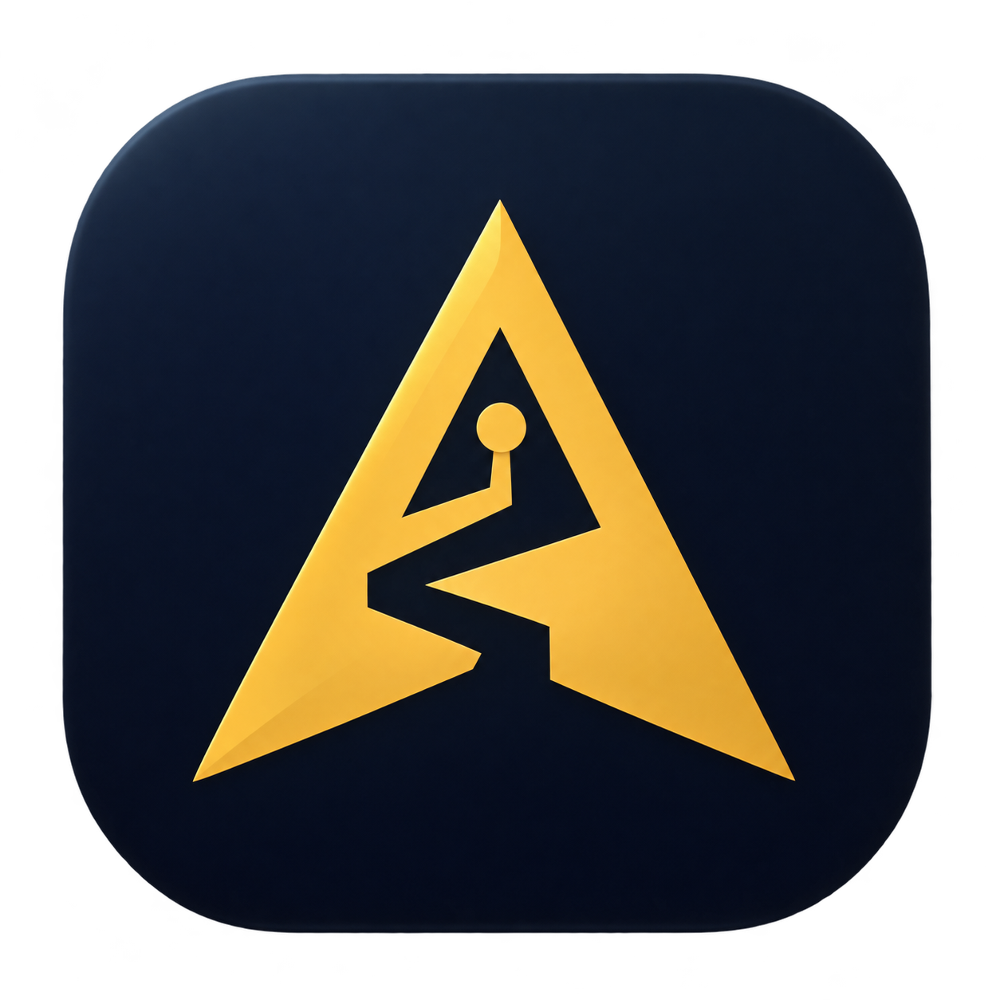
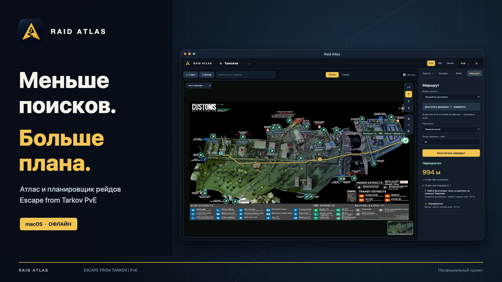
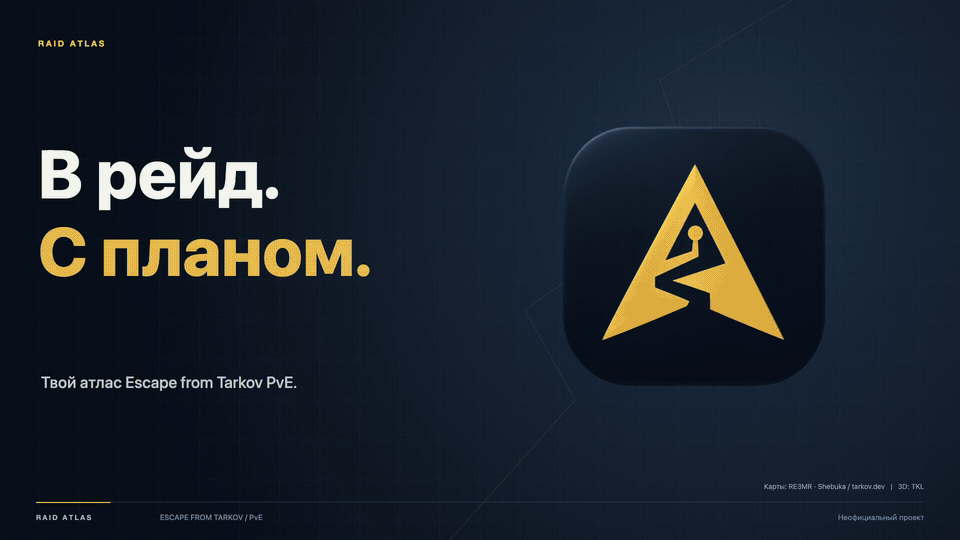

  
  <h1>Raid Atlas</h1>
  
<b>Less searching. More planning.</b> An offline Escape from Tarkov PvE map companion and raid planner for macOS.

  
<a href="https://github.com/Estoutic/raid-atlas/releases/latest"><b>Download for Mac</b></a> · <a href="https://github.com/Estoutic/raid-atlas/releases/download/v0.10.2/Raid-Atlas-Promo-v2-1080p.mp4">Watch the 35-second demo</a> · <a href="README.md">Русский</a>

Pick your quests, check the keys and items you need, then plan a route from your start through your objectives to an available extraction. You do not need the game installed on your Mac. Maps and quest data are bundled for offline use. **The application UI and promo are in Russian; quest search also accepts English names.**

Music: [Venom by Scott Buckley](https://www.scottbuckley.com.au/library/venom/), CC BY 4.0. Edited excerpt.

## Features

- **12 locations, 338 PvE quests and 134 extraction records**, including separate PMC/Scav records at some locations.
- A rotatable **3D Factory**, rendered maps for other locations and **17 additional vector floor plans**.
- Building and room search that opens the matching map and floor.
- Quest progress, required keys and items, plus a personal key checklist.
- Route planning through up to **10 objectives**, comparing the full path to extractions you mark as available.
- **All / PMC / Scav** extraction filters and floor transitions.
- Manual waypoints for The Labyrinth, Icebreaker and Terminal.
- Local persistence of quests, progress, starts, extraction choices and manual plans.

Maps: Factory, Customs, Shoreline, Woods, Reserve, Lighthouse, Interchange, Ground Zero, Streets of Tarkov, The Labyrinth, Icebreaker and Terminal. Labs and PvP are not included. Terminal has manual planning but no quests or extractions in the bundled catalog.

## Install

1. Download `Raid-Atlas-0.10.2-mac-universal.dmg` from [Releases](https://github.com/Estoutic/raid-atlas/releases/latest).
2. Open the DMG and drag **Raid Atlas.app** into **Applications**.
3. Eject the disk image and launch the app.

Universal **Apple Silicon + Intel**, built with a **macOS 12** deployment target. Tested on Apple Silicon with macOS 15.6.1 and as x86_64 through Rosetta; physical Intel hardware and macOS 12 have not been tested. No Python, Node.js or Xcode is needed to use the app. A SHA-256 checksum accompanies each installer.

The preview is ad-hoc signed, without Apple Developer ID signing or notarization. If macOS blocks a build you trust, try opening it, then use **System Settings → Privacy & Security → Open Anyway**. See [Apple's instructions](https://support.apple.com/102445).

## Know the limits

Raid Atlas does not connect to the game or track your live position. Bundled data is a **2026-11-16 snapshot** with local corrections, not a live feed. Routes use an approximate grid from published maps; alignment can vary and routes have not all been verified in gameplay. The lower-risk mode accounts for known boss areas, not live threats. Verify doors, paths and extraction conditions in the game. Manual plans connect points without obstacle avoidance.

[Development and checks](docs/BUILDING.md) · [Changelog](CHANGELOG.md) · [Release process](docs/RELEASING.md) · [Report an issue](https://github.com/Estoutic/raid-atlas/issues/new/choose)

## Credits

An unofficial, noncommercial project, unaffiliated with Battlestate Games. Escape from Tarkov and game materials belong to their respective owners.

Map art by **RE3MR**, **Shebuka and the tarkov.dev community** and derived annotations: **CC BY-NC-SA 4.0**. Unmodified **TKL** models: **CC BY-NC-ND 4.0**. Three.js: MIT. Draco: Apache 2.0. The original Raid Atlas logo was generated for this project.

Read **[THIRD_PARTY.md](THIRD_PARTY.md)** for complete attribution and license notices. Media production sources and credits are in [promo/README.md](promo/README.md).
