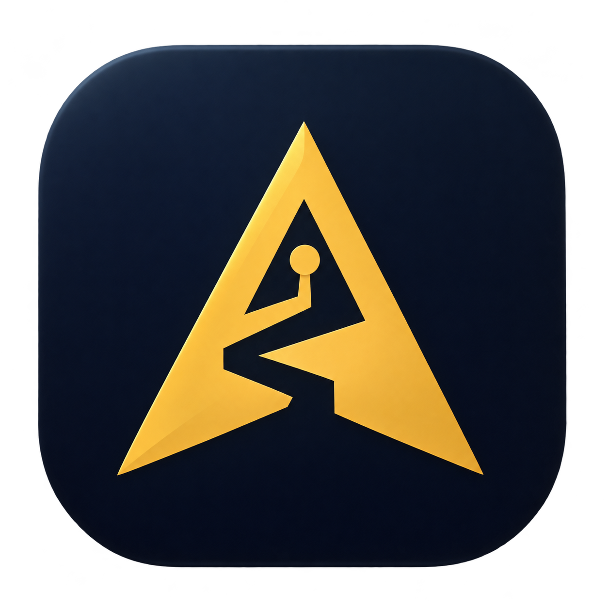
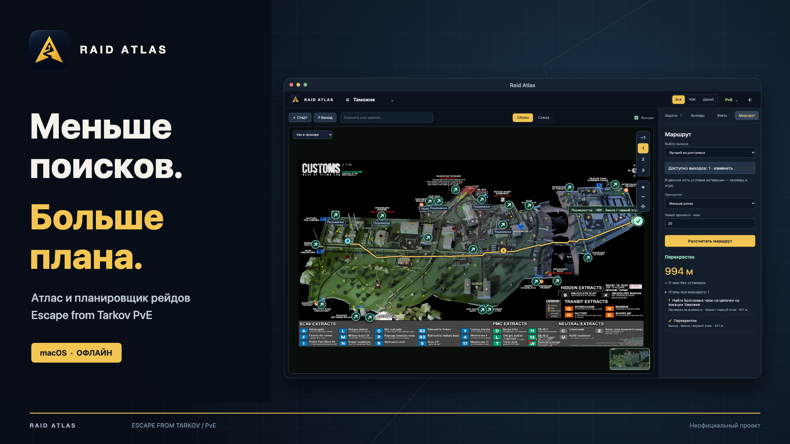
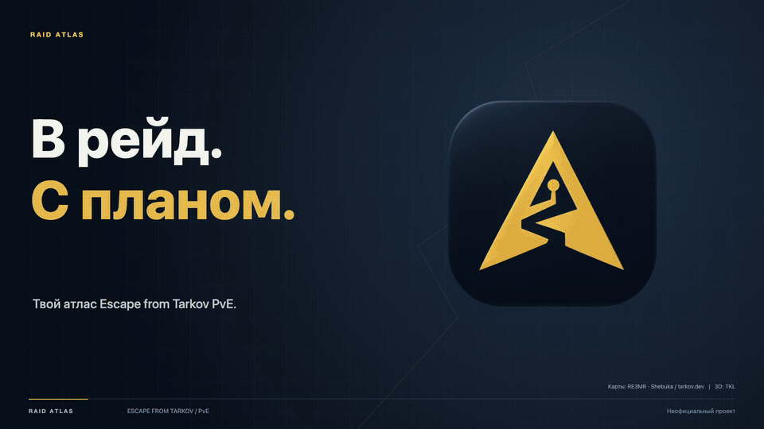

  
  <h1>Raid Atlas</h1>
  
<b>Меньше поисков. Больше плана.</b> Карты и планировщик рейдов Escape from Tarkov PvE для macOS.

  

    
    
    
    
  

  
<a href="https://github.com/Estoutic/raid-atlas/releases/latest"><b>↓ Скачать для Mac</b></a> · <a href="https://github.com/Estoutic/raid-atlas/releases/download/v0.10.2/Raid-Atlas-Promo-v2-1080p.mp4">▶ Смотреть ролик · 35 секунд</a> · <a href="README.en.md">English</a>

Ты знаешь название задания. Осталось вспомнить этаж, взять нужный ключ и понять, к какому выходу идти. **Raid Atlas собирает подготовку к рейду в одном окне:** выбери задачи, проверь вещи и построй маршрут через цели до отмеченного выхода.

Игра на Mac не нужна. Карты и каталог включены в приложение и работают без интернета. Интерфейс — на русском.

## Посмотри в действии

**[Полный ролик со звуком · 1080p](https://github.com/Estoutic/raid-atlas/releases/download/v0.10.2/Raid-Atlas-Promo-v2-1080p.mp4)** — Лес, обновлённая Таможня, Берег, Развязка и Завод. Живые действия, поиск комнаты, этажи и 3D. Музыка: [Venom — Scott Buckley](https://www.scottbuckley.com.au/library/venom/), CC BY 4.0. [Медиаматериалы и авторы](promo/README.md).

## Что помогает в рейде

| Когда нужно… | Raid Atlas |
| --- | --- |
| Собрать несколько заданий | **338 заданий PvE**, поиск по русскому и английскому названию, отметки выполненных этапов |
| Найти здание или комнату | Поиск по каталогу с переходом на нужную карту и этаж; **17 векторных планов** |
| Проверить подготовку | Ключи, предметы и условия выбранных этапов, собственная связка ключей |
| Наметить путь | Старт → до **10 целей** → выход; приоритет «Короче» или «Меньше риска» |
| Выбрать из доступных выходов | Сравнение полного маршрута до отмеченных выходов; фильтр **Все / ЧВК / Дикий** |
| Разобраться в локации | **12 карт**, вращаемый 3D-Завод, объёмные изображения остальных локаций и схемы этажей |
| Проложить свой путь | Ручные точки на Лабиринте, Ледоколе и Терминале |
| Вернуться к подготовке позже | Локальное сохранение задач, отметок, стартов, выходов и ручных планов |

<b>Все 12 локаций</b>

Завод · Таможня · Берег · Лес · Резерв · Маяк · Развязка · Эпицентр · Улицы Таркова · Лабиринт · Ледокол · Терминал.

В каталоге 134 записи выходов, включая отдельные записи ЧВК и Диких в одном месте. Лаборатория и PvP пока не добавлены. На Терминале нет заданий и выходов в исходном каталоге — доступен ручной план.

## Установка за минуту

1. Скачай **`Raid-Atlas-0.10.2-mac-universal.dmg`** из [последнего релиза](https://github.com/Estoutic/raid-atlas/releases/latest).
2. Открой DMG и перетащи **Raid Atlas.app** в **Applications («Программы»)**.
3. Извлеки образ и запусти приложение из «Программ».

**Apple Silicon + Intel · macOS 12+ — целевая версия сборки.** Python, Node.js и Xcode для запуска не нужны. Запуск проверен на Apple Silicon с macOS 15.6.1; x86_64 — через Rosetta. Физический Intel Mac и macOS 12 отдельно не проверялись.

Сборка подписана ad-hoc, без Apple Developer ID и notarization. Если macOS блокирует доверенную сборку, после попытки запуска открой **«Системные настройки → Конфиденциальность и безопасность → Всё равно открыть»**. [Инструкция Apple](https://support.apple.com/102445) · [Подробная установка](packaging/Установка.txt).

Рядом с установщиком опубликован SHA-256 для проверки файла.

## Твой первый план

1. Выбери локацию и добавь задания во вкладке **«Задачи»**.
2. Открой **«Взять»**: проверь ключи, предметы и условия.
3. Поставь **старт** и отметь выходы, доступные в текущем рейде по списку в игре.
4. Нажми **«Рассчитать маршрут»**. Переключай этажи и отмечай выполненные этапы.

## Что учитывать

- Это **планировщик**, который не подключается к игре и не определяет твою позицию или текущую обстановку.
- Данные — встроенный снимок от **16.11.2026** с локальными исправлениями. Автоматического обновления нет.
- Маршруты построены по приближённой сетке опубликованных схем. Привязка к объёмным изображениям местами приблизительная; игровым прохождением все маршруты не проверены.
- «Меньше риска» учитывает известные зоны боссов. Закрытые двери, противники и текущая проходимость автоматически не определяются. Условия выходов сверяй с игрой.
- На Лабиринте, Ледоколе и Терминале ручные точки соединяются **без обхода препятствий**.

[Аудит выходов и карт](sources/exit-audit.md) · [Исходники и проверки](docs/BUILDING.md) · [Изменения версий](CHANGELOG.md) · [Как выпускаются релизы](docs/RELEASING.md)

## Авторы карт и права

Неофициальный некоммерческий проект, не связанный с **Battlestate Games**. Escape from Tarkov и игровые материалы принадлежат их правообладателям.

Карты **RE3MR**, **Shebuka и сообщества tarkov.dev**, производные аннотации — **CC BY-NC-SA 4.0**. Оригинальные модели **TKL** — **CC BY-NC-ND 4.0**, включены без изменений. Three.js — MIT; Draco — Apache 2.0. Собственный логотип Raid Atlas создан для этого приложения.

**[Полная атрибуция и лицензии → THIRD_PARTY.md](THIRD_PARTY.md)**

Нашёл ошибку в карте или выходе? [Создай issue](https://github.com/Estoutic/raid-atlas/issues/new/choose) с локацией, этажом и скриншотом. Не прикладывай личные данные аккаунта.
